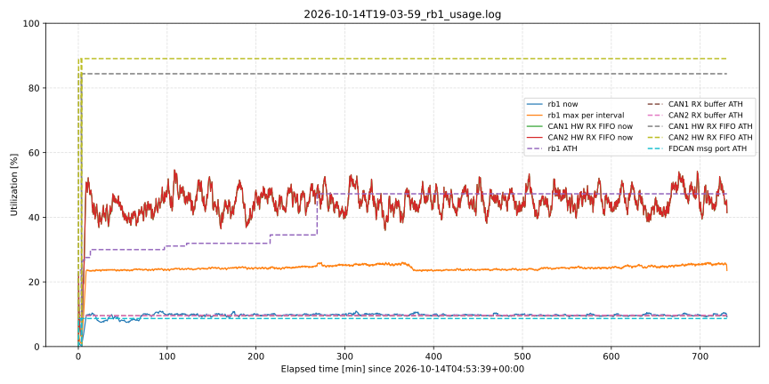
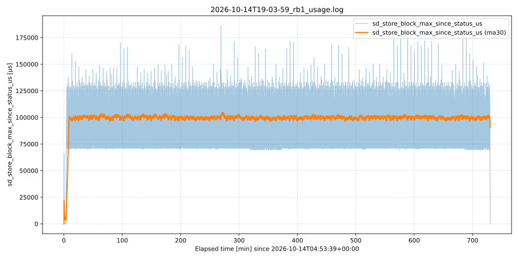

# Losslessnes test 2026-10-14

*tested on: v0.4.0-114-ge1384e0*

12 h soak test of the logger at ~105 % bus load on both CAN channels. Used as merge gate for `integration` → `main`.

## Setup

- Build: Release, CM7, `Pre_Release_CM7` preset
- Static TX replay on both FDCAN channels (`FDCAN_MODE_EXTERNAL_LOOPBACK`, channel mask `3U`)
- ID sequence check enabled (`debug_check_can_frame_id_sequence=1U`)
- Component trace: `filehandler`
- SD card: NCard 1.0, 29818 MB, manufactured 2023-08

The file [rb1_usage.log.gz](./rb1_usage.log.gz) holds the stats polled every 10 s from the REST API with `tools/poll_rb1_usage.sh`. [rb1_process.log](./rb1_process.log) is the console output of the poller.

## Results

Relevant run: 2026-10-14T04:57:34+00:00 → 2026-10-14T17:03:30+00:00 (12 h 06 min)

| Metric | Result |
|---|---|
| Bus load | ~104.8 % on CAN1 and CAN2 throughout |
| Frames logged | 1,769,385,434 (ingress = SD buffer egress) |
| SD blocks written | 378,155, 0 errors |
| Dropped / lost frames, sequence gaps, ID sequence errors | 0 |
| CAN protocol / warning / passive / bus-off events, ECR | 0 |
| `/logger/errors` total | 0 |
| rb1 high-water | 47.25 % (247,700 / 524,288 B) at 09:22:37 (~269 min) |
| rb1 typical fill | ~10 % (now), ~24–26 % (max per 10 s interval) |
| SD store block | typ. ~65 ms, max 186 ms |
| HW RX FIFO0 fill (snapshot) | avg ~45 %, 10–53 of 64 elements |
| HW RX FIFO0 high-water | 84.38 % (CAN1) / 89.06 % (CAN2) |
| CAN RX buffer high-water | 9.53 % (CAN1) / 9.69 % (CAN2) |
| FDCAN msg port high-water | 8.67 % |

Notes:

- The `f_sync` path was not exercised (all syncs skipped by design), so this test gives no power-loss durability coverage.
- A short aborted run and a device restart preceded the soak (04:53–04:57). The `unknown` row at 04:56:59 is a poller timeout during the restart (see [rb1_process.log](./rb1_process.log)), not a firmware response.
- The counters cover the path from right after the FDCAN ISR to right before the SD block write. The SD card content itself was not read back for this test.

## Plots

The x axis is the elapsed time in minutes since the first log row (2026-10-14T04:53:39+00:00); the soak itself starts at ~4 min.

Buffer utilization over time (solid: current fill, dashed: all-time high):



Max SD store block duration per 10 s interval:



The plots were created from repo root with:

```sh
gunzip -k doc/measurements/losslessnes/2026-10-14/rb1_usage.log.gz

python3 tools/plot_rb1_usage.py doc/measurements/losslessnes/2026-10-14/rb1_usage.log \
  --skip-invalid --buffers --smooth 30 --out buffers_utilization.svg

python3 tools/plot_rb1_usage.py doc/measurements/losslessnes/2026-10-14/rb1_usage.log \
  --skip-invalid --metric sd_store_block_max_since_status_us --smooth 30 \
  --out sd_store_block_max_since_status_us.svg
```
